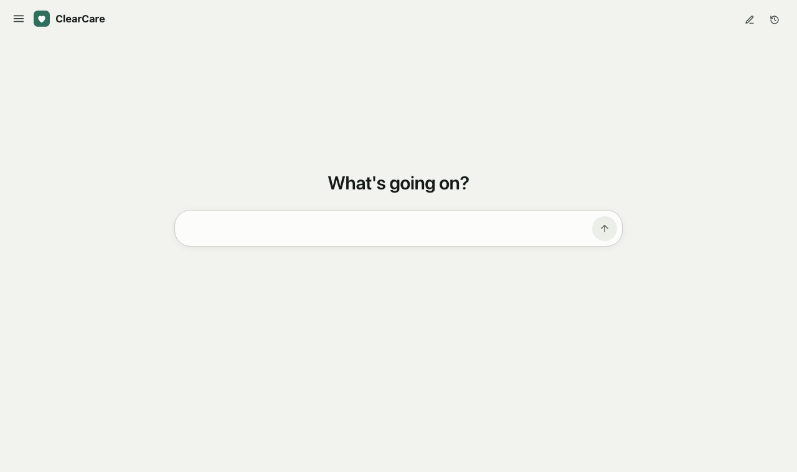
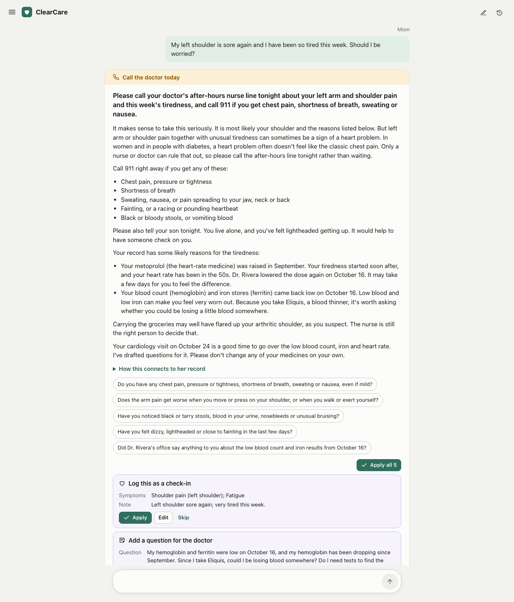
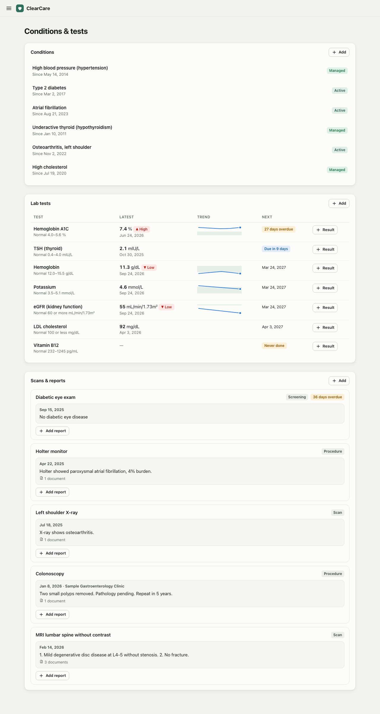
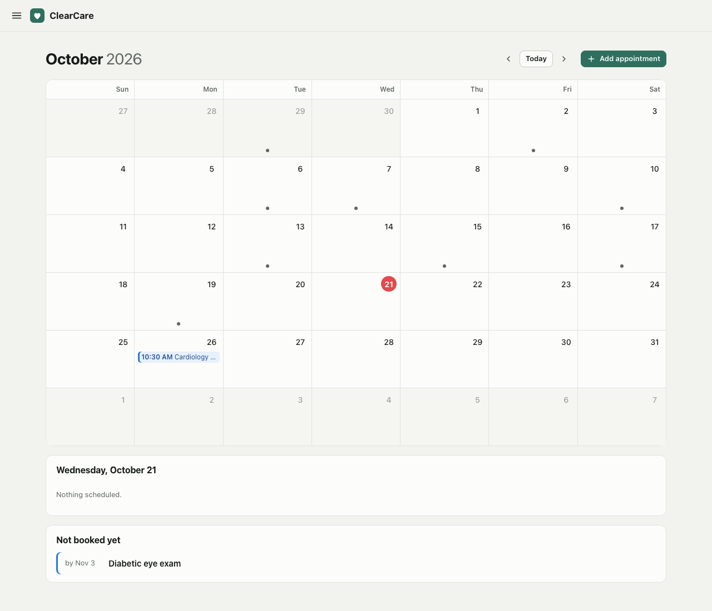
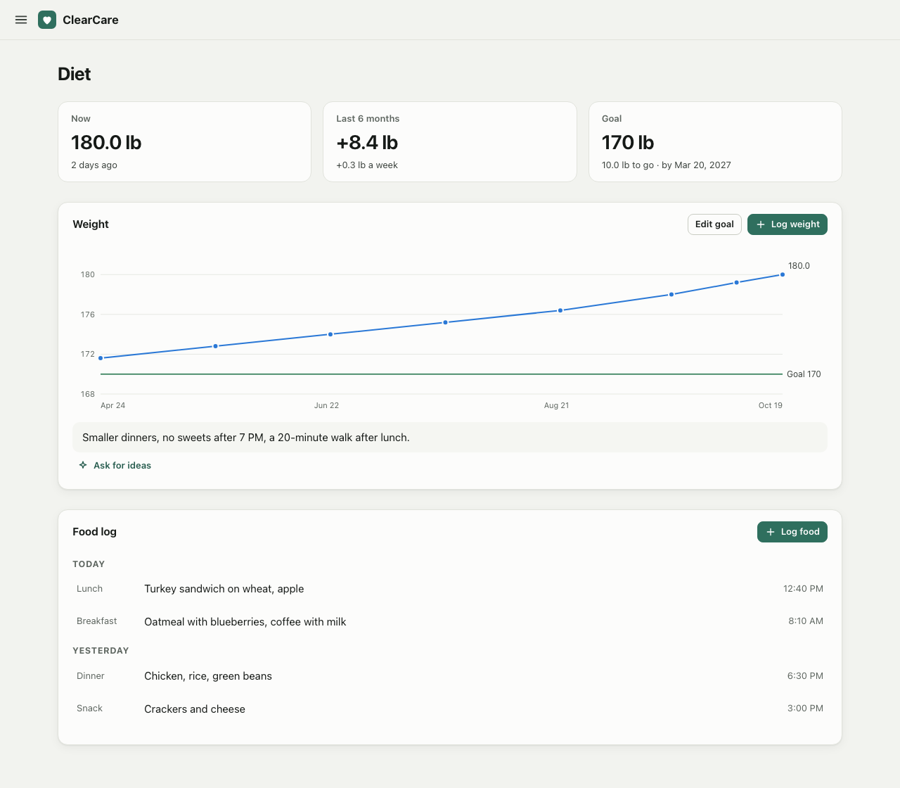
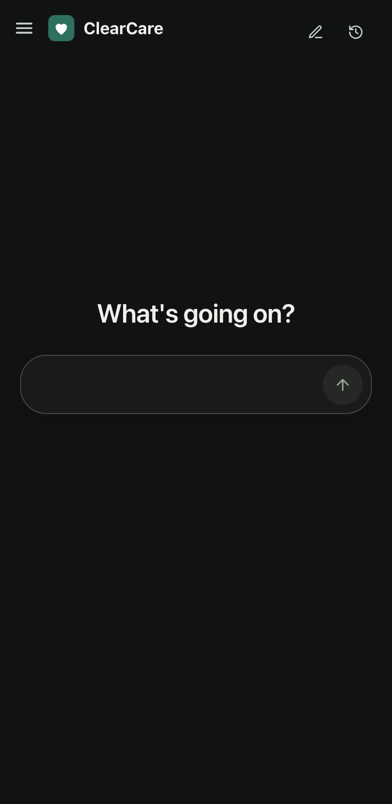
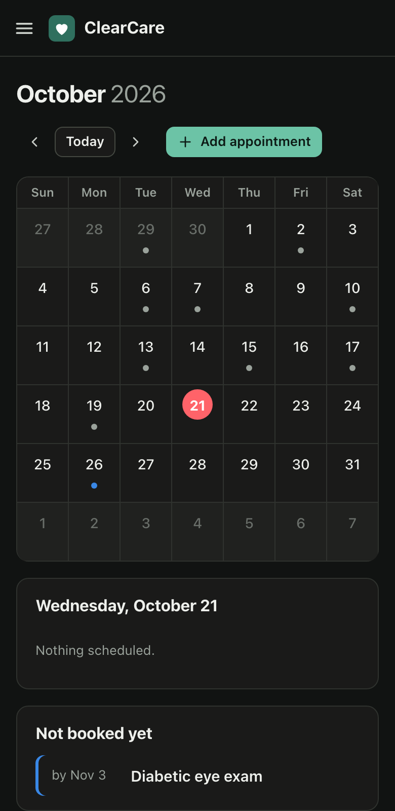
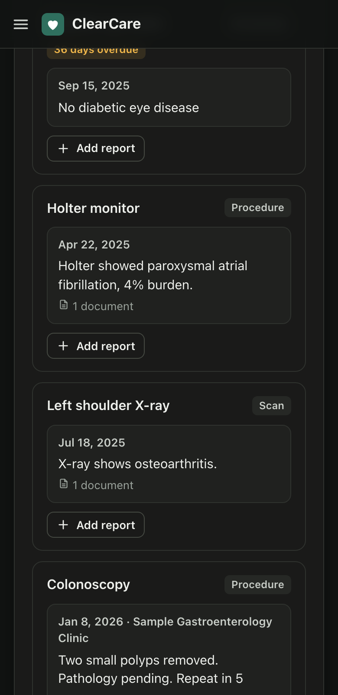

# ClearCare

A private health record with an AI that reasons over it, built for one family looking after one person (in our
case, Mom). It runs on a Mac at home. The family reaches it from their phones over Tailscale, with no public server
and no accounts.

You tell it what's going on ("she's been sluggish all week and her left arm hurts"), and it reads her whole record.
That covers medications and their dose changes, diagnoses, lab trends, recent symptoms, visits and uploaded documents.
It rates how urgent this is, explains what in her record could be connected, and proposes the next step. You can also
just tell it what changed ("her metoprolol went down to 25 mg today", "book cardiology Nov 3 at 2pm") and it turns
that into record changes you apply with one tap.



> Not a medical device and not production software. The AI can be wrong and is not anyone's doctor. In an
> emergency, call 911. All data in this repository and its screenshots is fictional.

---

## What it does

| Page | What's on it |
|---|---|
| **Home** | The chat. One heading, one input. Answers rate urgency, link the concern to records with quotes, list other possible causes, ask follow-up questions, and propose changes to any record. |
| **Profile** | Birth date, sex, height, blood type, allergies, primary doctor, pharmacy, preferred hospital, mobility aids, living situation, advance directive, healthcare proxy, emergency contact, insurance. Age and BMI are computed. |
| **Schedule** | An Apple Calendar style month: appointments, past visits with their notes and documents, visits still to book, questions to ask at each visit. Logged symptoms, vital signs and weights show on their day. |
| **Medications** | What she takes now, what each is for, with every dose and status change kept in a history. |
| **Conditions & tests** | Diagnoses with their status over time. **Lab tests** have values, normal ranges, high and low flags, trends and due dates. **Scans & reports** (MRI, X-ray, mammogram, biopsy, colonoscopy, Holter) have an impression, findings, place, doctor and linked documents. A date can be a month, like "March 2026". |
| **Diet** | Weight against a goal, the change over six months and 30 days, a food log, and a button that asks the AI for a realistic plan. |
| **Documents** | Upload anything: patient-portal exports, PDFs, photos of pages. Each upload is read on the Mac so the chat can use it, for example to build her visit history or save a scan report. |
| **Settings** | Who may sign in, her doctors, appearance, a download of the record, and AI usage. |

<table>
<tr>
<td width="50%"></td>
<td width="50%"></td>
</tr>
<tr>
<td></td>
<td></td>
</tr>
</table>

<p align="center">



</p>

---

## Architecture

```
  Phones and laptops                    THE MAC AT HOME
  ┌──────────────────┐   Tailscale    ┌───────────────────────────────────────────────────────────────┐
  │ Browser          │   Serve, HTTPS │ apps/server  (Node 22, node:http, no framework)               │
  │ (React app)      │ ─────────────▶ │  tailnet door 127.0.0.1:8092  only listed Tailscale logins    │
  └──────────────────┘   tailnet only │  local door   127.0.0.1:8090  this Mac                         │
                                      │                                                               │
                                      │  routes ─▶ commands ─▶ packages/domain (all rules, pure TS)   │
                                      │    │                         │                                │
                                      │    │                         ▼                                │
                                      │    │               data/health.json  (one file, atomic writes,│
                                      │    │               daily backups, owner-only, git-ignored)    │
                                      │    │                                                          │
                                      │    ├─▶ document reader ─▶ data/documents/FILE-n.*             │
                                      │    │     XML: domain parser   PDF, images: Swift helper       │
                                      │    │     (PDFKit, Vision)     Word, RTF: textutil             │
                                      │    │                                                          │
                                      │    └─▶ AI jobs: build input ─▶ engine ─▶ validate ─▶ store run │
                                      └──────────────────────────────────────┬────────────────────────┘
                                                                             │ JSON packet + JSON schema
                                                                             ▼
                                      Codex CLI on a ChatGPT plan (default), OpenAI API, or Claude
```

| Layer | Technology and role |
|---|---|
| `apps/web` | React 18, Vite 7, React Router. Eight pages, a slide-out page menu, hand-drawn SVG charts, light and dark themes. It shows what the server computed and sends commands, IDs and words. |
| `apps/server` | Node 22 `http`, no framework. Two doors on 127.0.0.1, a JSON store, gzip and immutable caching for the app, uploads, the document reader, and the AI jobs. |
| `packages/domain` | Every rule, in pure TypeScript with no React, SDK, file or network access. Covers commands and status history, due dates, flags, computed facts, red flags, document parsing and selection, prompts, schemas and validators. Lab values are exact decimal text. |
| `apps/server/native` | `doctext.swift`, built with `swiftc` on first use. It reads PDF text with PDFKit and recognizes text in images and scanned pages with Vision. |
| Storage | One JSON file per household, written atomically, with a backup each day. The document text sits beside each upload, so the app's payload stays small. |
| Tooling | Node 22.13 via mise, npm workspaces, Vitest, tsx, strict TypeScript. |

### How a question is answered

1. **The browser sends the chat's ID and the person's words.** Nothing else comes from the browser.
2. **Code checks the words for red flags first.** `redflags.ts` matches chest pain, stroke signs, arm or jaw pain with
   sweating, fainting, a head injury on a blood thinner, and more. It shows the advice as you type, and it sets a
   floor the AI's urgency may not go below.
3. **The server builds one JSON packet.** It holds the whole record, every record with its ID, and a `computed`
   section made by code: timing links ("fatigue started 8 days after the dose went up"), averages, flags, due dates,
   weight trends, age and BMI. It also lists every uploaded document, with the text of the ones that matter (see below).
4. **One call to the engine, with a strict JSON schema.** On the default engine, `codex exec` runs in an empty folder
   with every tool switched off: no shell, browsing or plugins.
5. **Code validates the answer.** Every cited ID must have been sent, and every quote must appear word for word in
   that record. Urgency must not be below the red-flag floor. Each proposed change is run, in order, on a copy of the
   record with the same rules as a person's edit, including "#N" links between changes in one answer. A failed check
   marks the run INVALID, and it is shown as such, never silently repaired.
6. **If the model needs more documents,** it lists their IDs. The server sends their full text and asks once more.
7. **Every run is stored.** Proposed changes appear as cards with Apply, Edit and Skip. Applying one runs the same
   tested commands as a person typing it in, and the record notes it came from the AI.

### Reading documents

| Upload | How it's read |
|---|---|
| Patient-portal export (C-CDA XML, e.g. Epic "Summary of Care") | Domain code parses each section's readable text: tables become one row per line. The header gives the visit's date and time, type, doctor and specialty, clinic and health system. |
| PDF | PDFKit text. A page without a text layer is rendered and read with Vision. |
| Photo or screenshot (PNG, JPEG, HEIC, …) | Vision text recognition, in reading order. |
| Word, RTF | macOS `textutil`. |
| Text, CSV, HTML | Read directly, tags removed. |

A few years of exports can hold hundreds of thousands of characters, too much for every question. So the model always
gets a listing of every document (title, date, visit, reason, diagnoses, sections) and the text that matters, within a
budget:

- documents the person names by a date, a month, or a word found in only a few documents' doctor, place or title
- short documents, sent whole
- then the sections that best match the question

A section repeated across documents is sent once. Measured on fictional data, a request to build the visit history
read 12 visit summaries in a second pass. It proposed 7 doctors, 12 past visits and 9 results, and all 28 passed the
checks.

### Rules that don't depend on the AI

- **Code does the numbers.** Due dates, flags, averages, timing links, weight change, age and BMI come from tested
  code. The model is told not to do arithmetic and to cite the computed facts instead.
- **No medication advice.** The prompt forbids telling anyone to start, stop or change a medication. It proposes a
  question for the prescriber instead.
- **Nothing changes until a person applies it.**
- **Urgency is calibrated like a phone triage nurse.** 911 is only for an emergency sign that is happening now.
  Otherwise the answer is "call today", with the specific signs that would mean 911.
- **The interface stays quiet.** No record IDs, model names or token counts on screen. Secondary actions live in
  edit windows.

### Privacy and sharing

- The server listens on 127.0.0.1 only. Family members reach it through
  [Tailscale Serve](https://tailscale.com/kb/1312/serve), which forwards to the tailnet door and stamps each request
  with the signed-in Tailscale login. It also strips any copy a client sends. Only logins on the people list get in.
  Tailscale Funnel, the public mode, is never used.
- The record leaves the Mac only when someone asks the AI something. Then the JSON packet goes to the chosen engine.
  Uploads are read into text on the Mac, and the files themselves are never sent.
- `data/` is git-ignored. Tests, screenshots and the sample patient are fictional.
- For patients who connect a patient portal: [terms of use](TERMS.md) and [privacy policy](PRIVACY.md).

---

## Running it

```bash
mise install                 # Node 22.13
npm install
npm run dev                  # API on 8091, app on http://127.0.0.1:8090
```

The record starts empty. To look around first, load the fictional sample patient from Settings → Data (and clear it
there later), or just start telling the chat about her. To use the AI, pick an engine:

```bash
brew install --cask codex && codex login     # ChatGPT plan, no API credit (the default this project uses)
CLEARCARE_AI=codex npm run ai:check          # one real answer on the fictional sample; writes nothing
```

The other engines are the OpenAI API (`scripts/set-openai-key.sh` stores a key in the Keychain, then
`CLEARCARE_AI=openai`) and Claude (`CLEARCARE_AI=api` with `ANTHROPIC_API_KEY`, or `CLEARCARE_AI=cli` with the
Claude CLI).

| Command | What it does |
|---|---|
| `npm run dev` | API with restart on change, and the app with hot reload |
| `npm start` | Builds the app and serves everything from one server on 8090 |
| `npm test` | All domain tests: red flags, due dates, flags, commands, documents, AI validators |
| `npm run typecheck` | Type checks every package |
| `npm run ai:check -- "question"` | One real chat on the fictional sample, printed |
| `scripts/mac-service.sh install` | Runs ClearCare as a login service (8090 local, 8092 for Tailscale) |
| `scripts/tailscale-share.sh` | Shares the Tailscale door on your tailnet and prints the link |

| Setting | Default | Meaning |
|---|---|---|
| `CLEARCARE_AI` | `auto` | `codex`, `openai`, `api`, `cli`, `off`, or `auto` |
| `CLEARCARE_CODEX_MODEL`, `CLEARCARE_CODEX_EFFORT` | `gpt-6.1-sol`, `medium` | Model and chat effort on a ChatGPT plan |
| `CLEARCARE_OPENAI_MODEL`, `CLEARCARE_OPENAI_EFFORT` | `gpt-6.1-sol`, `high` | The same for the OpenAI API |
| `CLEARCARE_MODEL`, `CLEARCARE_EFFORT` | `claude-opus-5-5`, `high` | The same for Claude |
| `CLEARCARE_DATA_DIR` | `./data` | Where the record, backups and uploads live |
| `CLEARCARE_TAILNET_PORT` | off | The port only Tailscale Serve forwards to |

### Sharing it with family

1. `scripts/mac-service.sh install` keeps it running while the Mac is on.
2. Install Tailscale on the Mac and sign in, then run `scripts/tailscale-share.sh`.
3. Share the machine with family members from the Tailscale admin console. They install Tailscale on their phones.
4. Add their Tailscale logins under Settings, as family or as the patient. The AI talks to the patient as "you" and
   to family about her. Someone not yet on the list shows up under "Tried to sign in" with an Add button.
5. Keep the Mac from sleeping on power if it should always be reachable.

---

## Repository layout

```
apps/web/              the app: pages, forms, charts, theme
apps/server/           routes and doors, the store, the document reader, AI jobs and engines
apps/server/native/    doctext.swift: PDF text and image text recognition on macOS
packages/domain/       every rule and its tests; src/ai/ holds every prompt, schema and validator
scripts/               dev runner, AI check, Mac service, Tailscale sharing, Keychain key helper
docs/design.md         design records D1 to D13: what was decided, the options, and why
docs/screenshots/      fictional sample data only
data/                  the record, backups and uploads (git-ignored)
```

## Limits

- One patient, one household, one Mac. Phones reach it only while the Mac is on and awake.
- The red-flag rules are a safety net for common phrases, not a triage system.
- Document reading is plain text. Tables in PDFs arrive as lines, and handwriting may not be recognized.
- A chat answer takes about 35 seconds. One that reads extra documents takes about one and a half minutes.

ClearCare is the sibling of [ClearSpend](https://github.com/roshan-amble/clearspend) and follows the same rules: code
handles numbers, AI handles text, AI input comes from stored records only, every output is validated, and nothing
changes until a person acts.
